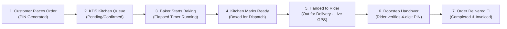

# Sweet Delights 🎂✨

> **Artisan Cake Boutique & Unified Multi-Role Delivery Ecosystem**  
> Order handcrafted cakes, customize tiers in 2D/3D with live icing calligraphy, schedule midnight celebration deliveries, and track live doorstep handovers with 4-digit OTP security.

Built with **Flutter (Material 3 Liquid Glass)**, **Node.js (Express REST API)**, and **MongoDB Atlas**.

---

## 🌟 Key Features & Ecosystem

### 1. 🛍️ Customer Mobile Application
- **Guest Browsing & Fast Checkout**: Explore cakes, categories, reviews, and promotional offers without prior sign-in.
- **🎨 Interactive Cake Customizer & Visual Preview**:
  - Customize cake base shape (Round, Heart, Square, Multi-Tier).
  - Select frosting flavor & color palette (Belgian Chocolate, Blush Rose, Pistachio, etc.).
  - Add gourmet toppings (Macarons, Gold Leaf, Fresh Berries, Ferrero Rocher).
  - **Live Icing Calligraphy**: Type custom piping greetings (e.g., *"Happy Birthday Saad"*) rendered in real-time script directly onto the cake preview.
  - Edible photo cake uploader.
- **⏰ Scheduled & Midnight Delivery Engine**:
  - Specific celebration date & time-window picker (Morning, Afternoon, Evening).
  - **Midnight Surprise Delivery** slot (11:45 PM – 12:15 AM) with gift packaging.
  - **Celebration Calendar**: Save family birthdays & anniversaries with proactive reminder notifications.
- **🗺️ Live GPS Delivery Tracking & Map View**:
  - Interactive route polyline from central kitchen to customer delivery pin.
  - Animated delivery scooter with real-time ETA countdown.
  - **🔐 Secure 4-Digit Doorstep PIN**: Secure verification code displayed on customer order tracking to share with the rider on cake handover.
  - One-tap phone call & WhatsApp chat buttons to contact the delivery partner.
- **Liquid Glass Design & Midnight Chocolatier Theme**:
  - Translucent frosted glass surfaces (`BackdropFilter`), specular borders, and tactile micro-animations.
  - Dark mode option with deep espresso tones (`#120B09`) and champagne gold accents (`#E6B980`).

---

### 2. 👨‍🍳 Bakery Operations & Kitchen Display System (KDS)
- **Tablet-Optimized Live Kitchen Screen**:
  - Real-time order pipeline across 4 stages: **Queue** $\to$ **Baking** $\to$ **Ready** $\to$ **Dispatch**.
  - Color-coded urgency prep timers (Green: Fresh $\to$ Amber $\to$ Urgent).
  - High-visibility **Chef Piping & Custom Message Callout Box** highlighting personalized cake piping instructions.
  - **Thermal Receipt & PDF Invoice Generator**: One-tap printable PDF tax invoices with itemized taxes, cake flavor/size, and store branding.
  - One-tap **"Hand to Rider"** dispatch action with automatic delivery partner assignment.
- **Admin Management Portal**:
  - Complete store dashboard with revenue analytics, order trend charts, and sales breakdowns.
  - Product catalog manager with instant "In Stock / Sold Out" switches and live image preview.
  - Promotional coupon & discount code management.
  - Customer directory with lifetime order history and total spend metrics.

---

### 3. 🛵 Unified Delivery Partner (Rider) Portal
- Integrated directly into the same Flutter application via role-based authentication (`RIDER`).
- **On-Duty / Off-Duty Toggle**: Real-time availability switcher.
- **Pickups Tab**: Discover cakes marked **READY** at the bakery kitchen and claim them with 1-tap (*"Accept & Start Delivery"*).
- **Active Deliveries Tab**:
  - Customer delivery address with 1-tap **Google Maps Turn-by-Turn Navigation**.
  - Direct customer phone dialer and WhatsApp quick chat.
  - **Doorstep PIN Verification**: Rider enters customer's 4-digit PIN to safely finalize handover (*with emergency master override `0000`*).
- **Delivered History & Earnings Summary**: Track completed drops, trip counts, and daily performance metrics.

---

## 🏗️ Repository Architecture

```
├── backend/                  Node.js + Express REST API
│   ├── src/
│   │   ├── controllers/      Auth, Cake, Cart, Order, Rider, Admin, Promo
│   │   ├── middleware/       JWT authentication & role guards (CUSTOMER, ADMIN, RIDER)
│   │   ├── models/           Mongoose schemas (User, Cake, Order, CartItem, Promo)
│   │   ├── routes/           Express API routes
│   │   └── utils/            Order lifecycle state machine, validators, pricing
│   └── scripts/              Database seeds, rider provision, migration utilities
├── flutter-app/cake_shop/    Flutter Android & iOS Client
│   ├── lib/
│   │   ├── models/           Type-safe Dart data models
│   │   ├── providers/        12 Provider state managers
│   │   ├── screens/
│   │   │   ├── admin/        Dashboard, KDS, Products, Promos, Customers
│   │   │   ├── auth/         Login with 1-tap demo chips, Register, Forgot Password
│   │   │   ├── catalog/      Catalog, Detail Screen, 2D/3D Cake Customizer
│   │   │   ├── home/         Home Tab, Floating Navigation Bar
│   │   │   ├── orders/       Orders Tab, Detail Screen, PIN & GPS Route Tracker
│   │   │   ├── profile/      Profile, Celebration Calendar, Wishlist, Settings
│   │   │   └── rider/        Delivery Partner Portal (Pickups, Active, History)
│   │   ├── services/         API client, Invoice/PDF service, offline cache
│   │   ├── theme/            Liquid Glass design tokens & Midnight Chocolatier palette
│   │   └── widgets/          Glass UI system, interactive map, customizer canvas
├── database/                 MongoDB schema definitions & indexes
└── docs/                     Full SDLC documentation suite (SRS, SDD, UML, Test Plan)
```

---

## ⚡ Quick Start: Running Locally

### Prerequisites
- **Node.js** (v18+)
- **MongoDB** (Local instance or [MongoDB Atlas](https://www.mongodb.com/atlas))
- **Flutter SDK** (3.24+ / Dart 3.5+)
- Android Studio / VS Code with Flutter extensions

### 1. Backend API Setup
```bash
cd backend
cp .env.example .env
# Configure MONGODB_URI, JWT_SECRET, and PUBLIC_APP_URL in .env

npm install
npm run seed       # Seeds gourmet cakes and categories
npm run dev        # Starts server with nodemon hot-reload on port 3000
```
*Health Check: Verify `http://localhost:3000/health` in your browser.*

### 2. Flutter Mobile Application Setup
```bash
cd flutter-app/cake_shop
flutter pub get
flutter run
```

---

## 🔑 One-Tap Demo Test Accounts

The login screen features quick 1-tap role selector chips to test the end-to-end multi-role lifecycle effortlessly:

| Role | Email | Password | Primary Interface |
|:---|:---|:---|:---|
| **Customer** | `customer@test.com` | `test123` | Storefront, Customizer, Cart, Live GPS Tracking & PIN |
| **Bakery Kitchen (Admin)** | `admin@cakeshop.com` | `admin123` | Kitchen Display System (KDS), Dispatch, Store Metrics |
| **Delivery Partner (Rider)** | `rider@cakeshop.com` | `rider123` | Delivery Dashboard, Map Navigation, PIN Verification |

---

## 🔄 End-to-End Delivery Lifecycle Workflow



1. **Customer** orders a cake with optional midnight slot and custom piping text.
2. **Bakery Admin** opens the **KDS** (`Kitchen Display System`), sees the custom piping instructions, taps **"Start Baking"**, then **"Mark Ready"**.
3. Admin taps **"Hand to Rider"** (or the Delivery Partner claims it under **Pickups**). The order moves to `OUT_FOR_DELIVERY` and is linked to the rider.
4. **Customer** opens order tracking to view the animated scooter on the interactive route map, contact the rider, and view their **4-digit Doorstep PIN**.
5. **Rider** navigates to the customer doorstep via Google Maps, asks for the PIN, enters it into the delivery verification prompt, and marks the cake **Delivered**!

---

## 🚀 Production Build & Deployment

### Backend Deployment (Render / Railway / Heroku)
1. Push `backend/` to your Git repository.
2. Set environment variables: `MONGODB_URI`, `JWT_SECRET`, `PUBLIC_APP_URL`.
3. Deploy as a Web Service.

### Flutter Production Release APK
Compile an optimized release APK pointing to your deployed production API:
```bash
cd flutter-app/cake_shop
flutter build apk --release \
  --dart-define=PRODUCTION_API_URL=https://your-api.onrender.com/api
```
The output APK is generated at:
`flutter-app/cake_shop/build/app/outputs/flutter-apk/app-release.apk`

---

## 🧪 Testing & Code Quality

- **Flutter Static Analysis**:
  ```bash
  flutter analyze
  ```
- **Flutter Test Suite** (Widget tests, design tokens, multi-role & lifecycle tests):
  ```bash
  flutter test
  ```
- **Backend Verification**:
  ```bash
  cd backend && node -e "const { VALID_STATUSES } = require('./src/utils/orderStatus'); console.log(VALID_STATUSES);"
  ```

---

## 📜 Documentation Index

Comprehensive Software Engineering SDLC artifacts are available in the [`docs/`](docs/) directory:
- [Software Requirements Specification (SRS)](docs/02_SRS_Software_Requirements_Specification.md)
- [System Design Document (SDD)](docs/03_System_Design_Document.md)
- [Database Schema & Design](docs/04_Database_Design.md)
- [UML Diagrams (Use Case, Sequence, Class, State)](docs/05_UML_Diagrams.md)
- [Test Plan & Verification Matrix](docs/06_Test_Plan_and_Test_Cases.md)
- [User Manual](docs/07_User_Manual.md)
- [Project Report](docs/08_Project_Report.md)

---

**Sweet Delights** — *Handcrafted Luxury Cakes, Delivered Fresh with Precision.*
