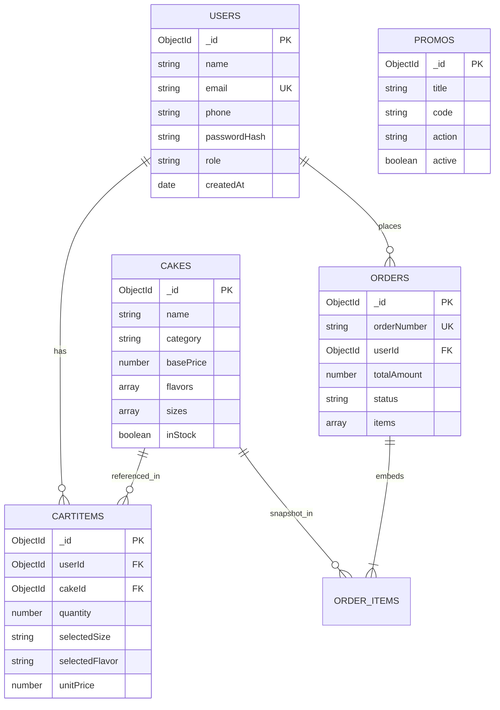

# Database Design

## Sweet Delights — Cake Online Shopping App

**Document ID:** DB-CAKE-001  
**Version:** 2.0  
**Date:** June 2026

> Full field list also in: [`database/mongodb_schema.md`](../database/mongodb_schema.md)

---

## 1. Overview

| Item | Value |
|------|-------|
| Database type | MongoDB (NoSQL) |
| ODM | Mongoose |
| Database name | `cake_shop` |
| Connection | `MONGODB_URI` in `backend/.env` |

The Flutter app **does not** connect to MongoDB directly. Only the Node.js server talks to the database.

---

## 2. Collections

| Collection | Purpose |
|------------|---------|
| users | Customer and admin accounts |
| cakes | Product catalog |
| cartitems | Shopping cart lines per user |
| orders | Placed orders with embedded items |
| promos | Home banners and discount codes |

---

## 3. Entity Relationship Diagram



---

## 4. Collection Details

### 4.1 users

| Field | Type | Notes |
|-------|------|-------|
| name | String | Required |
| email | String | Unique, lowercase |
| phone | String | Required |
| passwordHash | String | bcrypt, never plain password |
| role | String | `CUSTOMER` or `ADMIN` |

**Index:** email (unique)

### 4.2 cakes

| Field | Type | Notes |
|-------|------|-------|
| name | String | Required |
| description | String | Optional |
| category | String | BIRTHDAY, WEDDING, CUPCAKE, CUSTOM, SEASONAL |
| basePrice | Number | In INR |
| imageUrl | String | External image URL |
| flavors | [String] | e.g. Chocolate, Vanilla |
| sizes | [String] | e.g. 1kg, 2kg |
| rating | Number | 0–5 (seed value) |
| inStock | Boolean | true = available |

**Index:** category

### 4.3 cartitems

| Field | Type | Notes |
|-------|------|-------|
| userId | ObjectId | Ref → users |
| cakeId | ObjectId | Ref → cakes |
| quantity | Number | Min 1 |
| selectedSize | String | |
| selectedFlavor | String | |
| customMessage | String | Optional icing text |
| unitPrice | Number | Calculated at add time |

**Index:** userId

### 4.4 orders

| Field | Type | Notes |
|-------|------|-------|
| orderNumber | String | Unique, e.g. ORD-1730123456 |
| userId | ObjectId | Customer |
| subtotalAmount | Number | Before discount |
| discountAmount | Number | Promo discount |
| totalAmount | Number | Final amount |
| promoCode | String | Optional |
| status | String | PENDING … DELIVERED |
| deliveryAddress | String | Full address text |
| deliveryDate | Number | Unix timestamp ms |
| paymentMethod | String | COD, UPI, CARD |
| items | Array | Embedded line items |
| rating | Number | 1–5 after delivery |
| reviewComment | String | Optional |

**Embedded item fields:** cakeId, cakeName, quantity, size, flavor, customMessage, price

**Indexes:** userId, orderNumber, status

### 4.5 promos

| Field | Type | Notes |
|-------|------|-------|
| title | String | Banner title |
| subtitle | String | Banner text |
| action | String | DISCOUNT, INFO, BROWSE_CATEGORY |
| code | String | e.g. SWEET50 (for discount type) |
| discountPercent | Number | 0.5 = 50% |
| minOrder | Number | Minimum cart value |
| expiresAt | Number | Optional expiry timestamp |
| active | Boolean | Show on home or not |
| sortOrder | Number | Banner order |

---

## 5. Enumerations

### Order status
`PENDING` → `CONFIRMED` → `BAKING` → `READY` → `DELIVERED`  
Also: `CANCELLED`

### User role
`CUSTOMER`, `ADMIN`

### Cake category
`BIRTHDAY`, `WEDDING`, `CUPCAKE`, `CUSTOM`, `SEASONAL`

---

## 6. Sample / Seed Data

Run from backend folder:
```bash
npm run seed
```

| Account | Email | Password | Role |
|---------|-------|----------|------|
| Customer | customer@test.com | test123 | CUSTOMER |
| Admin | admin@cakeshop.com | admin123 | ADMIN |

Seed also adds ~24 cakes and 3 promo offers.

---

## 7. Normalization Note

We use **embedded order items** inside the order document because:
- Order items never change after placement  
- One query fetches full order for customer and admin  
- Common pattern in MongoDB e-commerce apps  

Cart is separate collection because it changes often before checkout.

---

## 8. Backup

- **Development:** MongoDB data folder or Atlas backup  
- **Atlas:** Free tier includes basic backup options  
- **Export:** `mongodump` for manual backup before demo  

---

## 9. Future schema changes

| Change | Reason |
|--------|--------|
| addresses collection | Sync addresses to server |
| payments collection | Store Razorpay transaction ID |
| reviews collection | Separate product reviews |

---

*See `backend/src/models/` for Mongoose schema code.*
