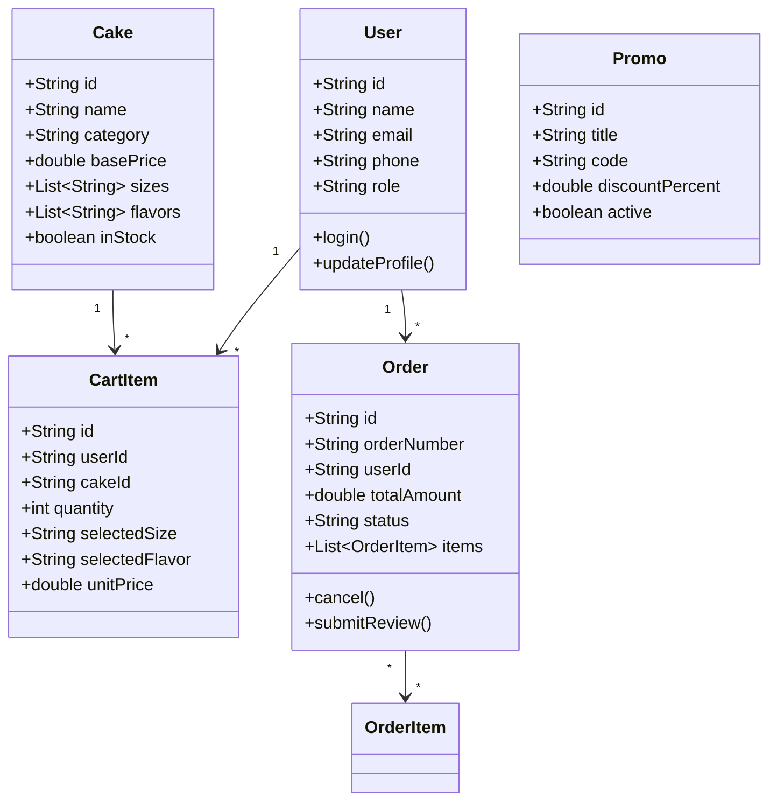
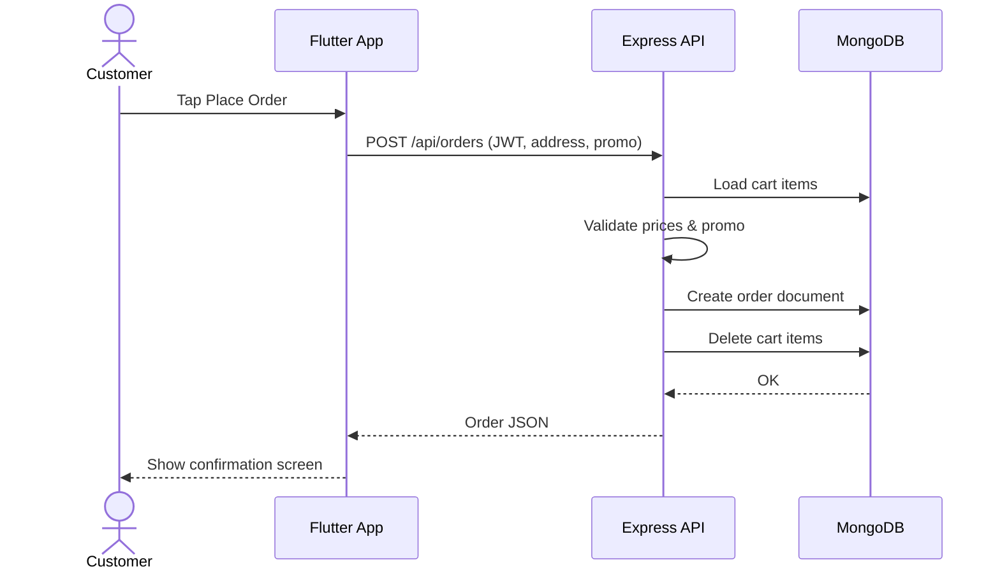
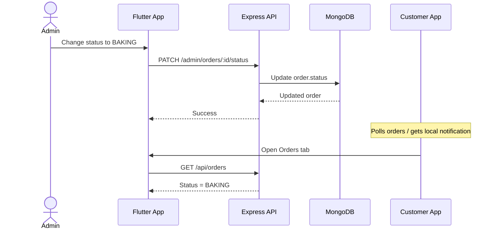
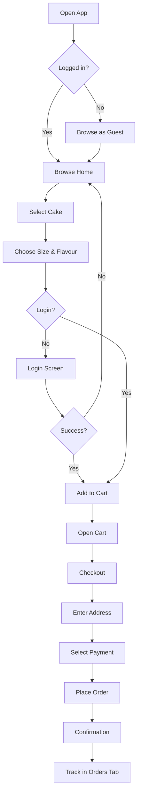
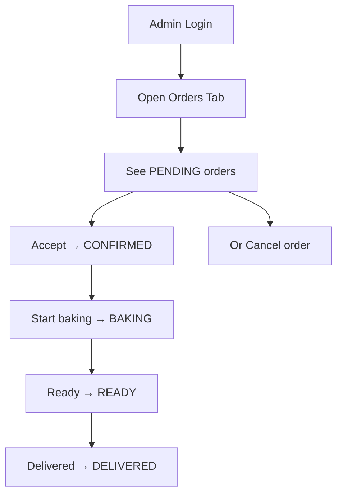
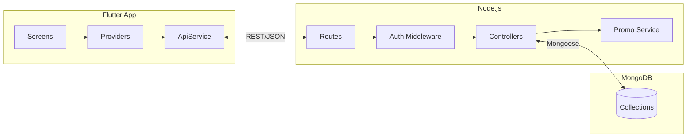
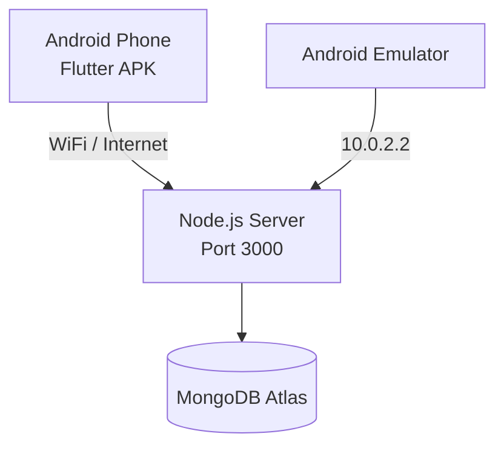

# UML Diagrams

## Sweet Delights — Cake Online Shopping App

**Document ID:** UML-CAKE-001  
**Version:** 2.0  
**Date:** June 2026

> Open `.md` files in VS Code with Mermaid preview, or paste diagrams in [mermaid.live](https://mermaid.live) for report/PPT images.

---

## 1. Use Case Diagram

```mermaid
flowchart TB
    subgraph System["Sweet Delights System"]
        UC1[Register]
        UC2[Login / Logout]
        UC3[Browse Catalog]
        UC4[Search & Filter]
        UC5[View Cake Detail]
        UC6[Add to Cart]
        UC7[Checkout]
        UC8[Track Orders]
        UC9[Cancel Order]
        UC10[Rate Order]
        UC11[Manage Menu]
        UC12[Update Order Status]
        UC13[Manage Offers]
        UC14[View Dashboard]
    end

    Guest((Guest))
    Customer((Customer))
    Admin((Admin))

    Guest --> UC3
    Guest --> UC4
    Guest --> UC5
    Guest --> UC2

    Customer --> UC1
    Customer --> UC2
    Customer --> UC3
    Customer --> UC4
    Customer --> UC5
    Customer --> UC6
    Customer --> UC7
    Customer --> UC8
    Customer --> UC9
    Customer --> UC10

    Admin --> UC2
    Admin --> UC11
    Admin --> UC12
    Admin --> UC13
    Admin --> UC14
```

---

## 2. Use Case Descriptions (Sample)

### UC-07 Checkout
| Field | Detail |
|-------|--------|
| Actor | Customer |
| Precondition | User logged in, cart not empty |
| Main flow | 1. Open checkout 2. Select address 3. Apply promo 4. Choose payment 5. Place order |
| Postcondition | Order created, cart cleared |
| Exception | Network error → show retry message |

### UC-12 Update Order Status
| Field | Detail |
|-------|--------|
| Actor | Admin |
| Precondition | Admin logged in |
| Main flow | 1. Open Orders tab 2. Select order 3. Change status 4. Save |
| Postcondition | Customer sees updated status |

---

## 3. Class Diagram (Logical)

---

## 4. Sequence Diagram — Place Order

---

## 5. Sequence Diagram — Admin Updates Status

---

## 6. Activity Diagram — Customer Order Flow

---

## 7. Activity Diagram — Admin Order Handling

---

## 8. Component Diagram

---

## 9. Deployment Diagram

---

*Draw these diagrams in your report using Mermaid export or redraw in Draw.io for submission PDF.*
